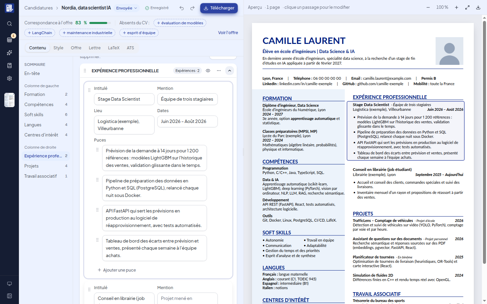
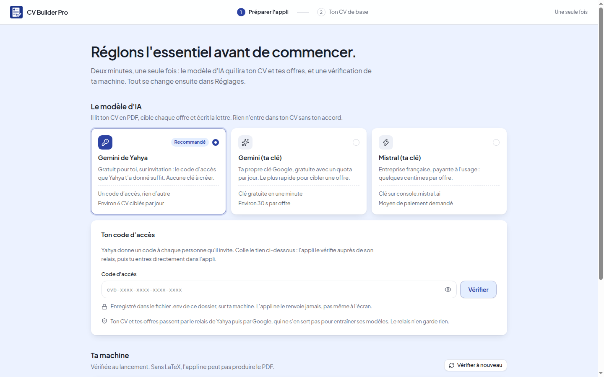
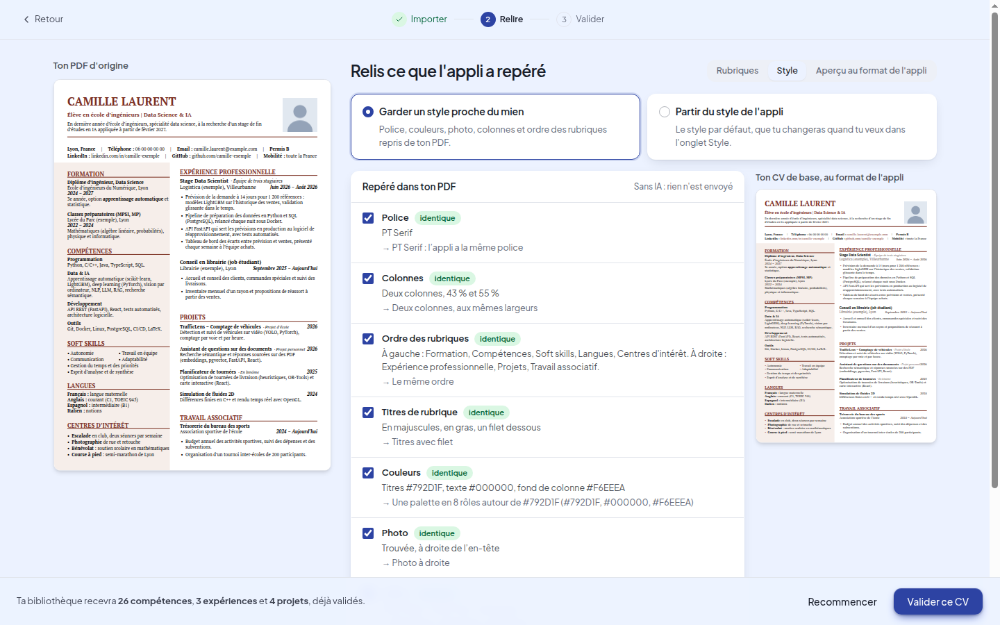
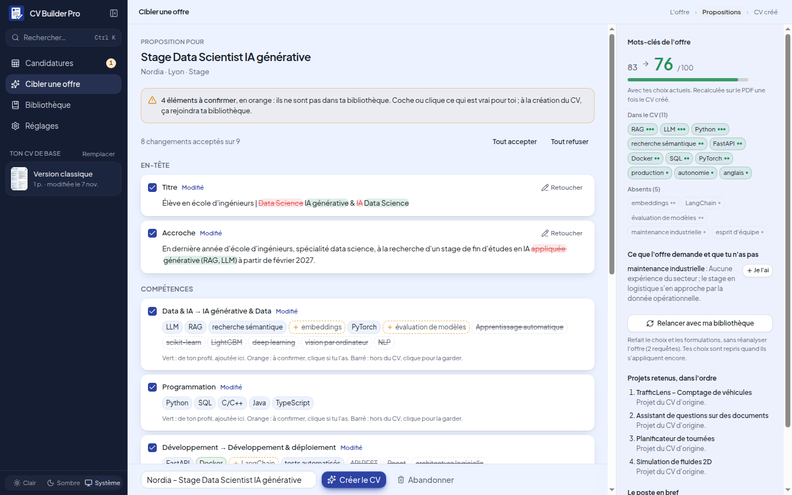
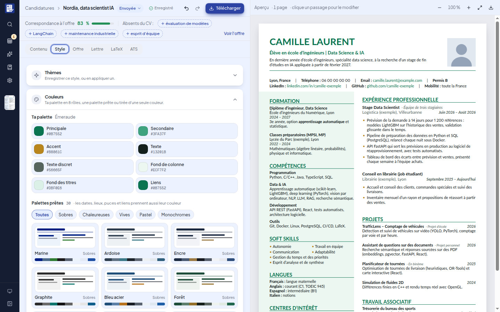
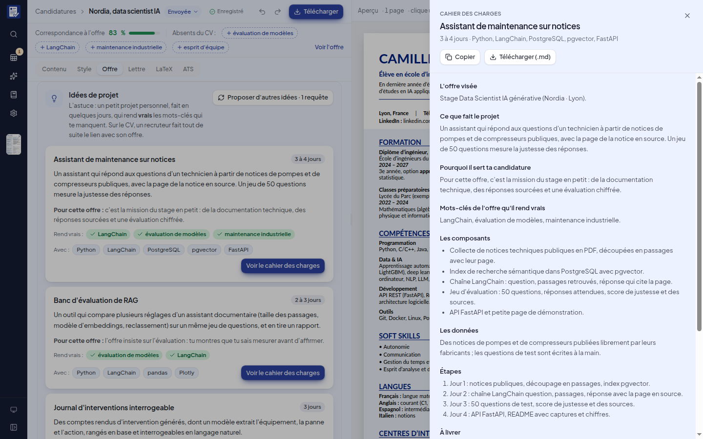
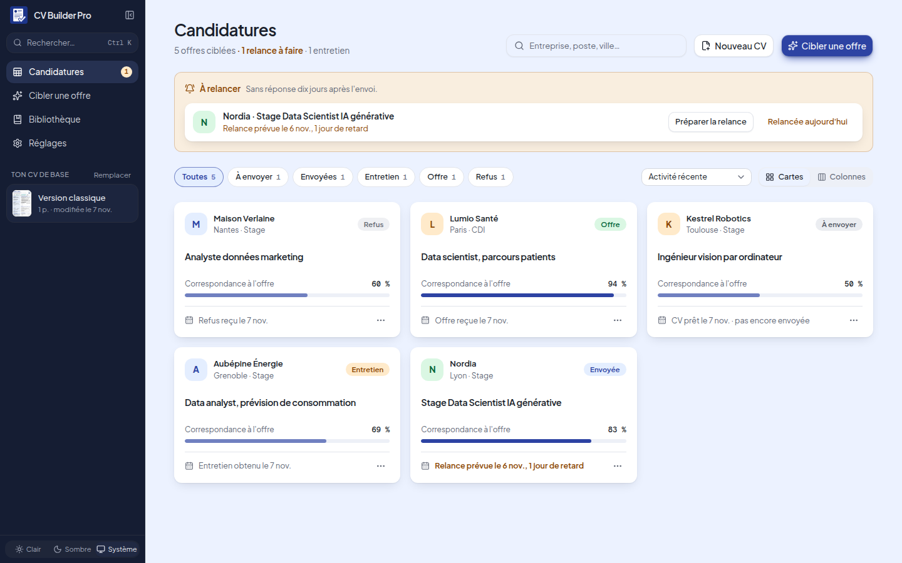
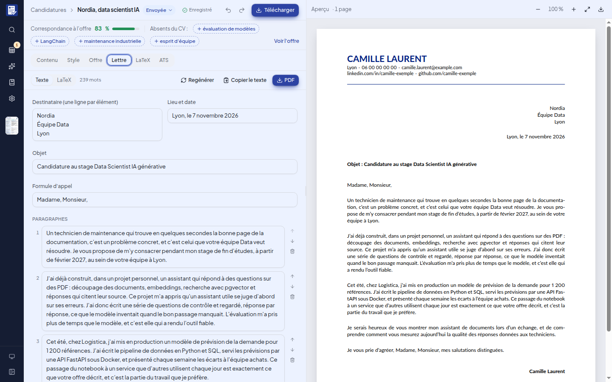
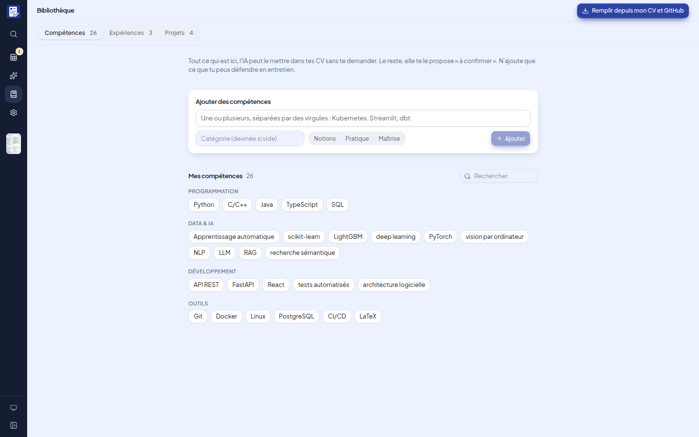

# CV Builder Pro

Un atelier local pour adapter son CV à chaque offre d'emploi. On colle une offre,
l'IA propose un CV qui en reprend le vocabulaire, et rien n'y entre sans ton
accord. Le CV reste un vrai document LaTeX d'une page, lisible par les logiciels
de tri des recrutements (ATS).

Tout tourne sur ta machine : tes CV, ta bibliothèque et tes clés d'API ne
quittent jamais le dossier du projet.

## Installation

### Windows 10 et 11

L'appli tourne dans WSL, le Linux intégré à Windows. **La première fois
seulement**, si WSL n'est pas encore installé, dans PowerShell ouvert **en
administrateur** :

```powershell
wsl --install -d Ubuntu
```

Redémarre le PC : Ubuntu s'ouvre et te demande un nom d'utilisateur et un mot de
passe. Ensuite, dans PowerShell :

```powershell
wsl -d Ubuntu -- bash -lc "cd && git clone https://github.com/yahyabmo/CV-builder-pro.git && CV-builder-pro/install.sh"
```

### Linux (Ubuntu, Debian)

```bash
git clone https://github.com/yahyabmo/CV-builder-pro.git && cd CV-builder-pro && ./install.sh
```

Dans les deux cas, le script installe ce qui manque (LaTeX, outils PDF, Python,
Node.js), prépare l'appli, pose l'icône **CV Builder Pro** sur le bureau et dans
le menu (menu Démarrer sous Windows), puis l'ouvre. Il ne demande ton mot de
passe Ubuntu ou Linux que pour installer des logiciels du système. Le relancer
met l'appli à jour.

### Démarrer

- **Par l'icône CV Builder Pro**, sur le bureau ou dans le menu : l'appli
  démarre en arrière-plan et s'ouvre dans ton navigateur, sur
  <http://localhost:8000> (ou le port libre suivant, si un autre programme
  occupe déjà le 8000). Pour l'arrêter : **Arrêter CV Builder Pro** dans le
  menu Démarrer (Windows), ou clic droit sur l'icône › Arrêter (Linux).
- **Par une commande**, si tu préfères. Ctrl+C l'arrête.

  ```powershell
  wsl -d Ubuntu -- bash -lc "cd && make -C CV-builder-pro start"   # Windows, dans PowerShell
  ```

  ```bash
  make start   # Linux, dans le dossier du projet
  ```

L'appli commence par le choix du modèle d'IA et de sa clé, puis ton CV de base.
Le détail de chaque étape, la mise à jour et Docker sont dans
[SETUP.md](SETUP.md). macOS n'est pas pris en charge.

## Ce que fait l'appli



### Prête en deux minutes

Au premier lancement, l'appli te fait choisir ton modèle d'IA (Gemini est
gratuit), te guide pour créer ta clé, la vérifie par un petit appel et
l'enregistre sur ta machine. Elle vérifie aussi LaTeX et les outils PDF, et
donne la commande à copier pour ce qui manque. Pas de fichier à modifier à la
main.



### Ton CV de base en quelques minutes

Ensuite, tu importes ton CV en PDF ou tu le remplis champ par champ.
L'appli recopie ton PDF sans le réécrire, te montre l'original à côté de ce
qu'elle a compris et signale ce qu'elle n'a pas su ranger. Ta bibliothèque se
remplit au passage.

Elle reprend aussi le **style de ton CV** : police, couleurs, photo, une ou deux
colonnes, titres, tailles et ordre des rubriques, lus dans le PDF sans IA. Tu
gardes ce qui te plaît, case par case, et l'aperçu suit tes choix.



### Un CV ciblé pour chaque offre

L'IA lit l'offre (texte, fichier ou adresse), puis propose les compétences, les
puces et les projets les plus utiles, reformulés dans son vocabulaire. Chaque
changement se coche ou se décoche. Une compétence absente de ton profil arrive
« à confirmer », et le score de correspondance suit tes choix en direct.



### Un éditeur qui va droit au but

- **Clic sur l'aperçu** : un clic sur un passage du PDF ouvre le champ qui l'a
  produit, curseur placé.
- **Correspondance à l'offre** toujours visible, avec les mots-clés absents.
  Un clic en ajoute un à tes compétences, avec un avertissement si l'analyse
  pense que tu ne l'as pas.
- **Aperçu en direct** : le PDF se recompile après chaque pause de frappe, sans
  clignoter, avec annuler et rétablir.
- **Style complet** : polices libres, titres de rubrique, encadrés, photo
  recadrée, marges, une ou deux colonnes, en-tête centré ou non, ordre des
  rubriques. Un style s'enregistre comme thème.

### Couleurs et palettes

Une palette en 8 rôles (principale, secondaire, accent, texte, texte discret,
fond de colonne, fond des titres, liens), **30 palettes prêtes** en cinq
ambiances, trois palettes tirées de ta couleur principale, un nuancier complet
dans chaque pastille et une alerte quand un texte devient peu lisible. Toutes
les palettes prêtes sont lisibles à l'écran comme à l'impression.



### L'astuce : un projet pour ce qui te manque

Pour chaque offre, l'appli propose trois idées de petits projets personnels,
faits en quelques jours, qui rendent vrais les mots-clés que ton CV n'a pas
encore. Chacune vient avec son cahier des charges : composants, données
gratuites, étapes, ce qu'il faut livrer, la ligne à mettre sur le CV une fois le
projet fait, et les questions qu'un recruteur posera.



### Le suivi des candidatures

Chaque CV ciblé est une candidature : statut, date d'envoi, relance proposée dix
jours après, contact, notes et historique. Les relances en retard remontent en
haut de la page, en cartes ou en colonnes.



### La lettre de motivation

Écrite à partir de l'offre, du CV et de deux réponses de ta part : pourquoi
cette offre te parle, et un détail sur l'entreprise qui t'a marqué. Elle se
retouche paragraphe par paragraphe, avec des alertes sur les tournures qui
sonnent « écrit par une IA ».



### La bibliothèque

Tout ce qui est vrai sur ton parcours, bien plus que ce qu'un CV montre :
compétences avec leur niveau, expériences avec leurs puces de réserve, projets.
Elle se remplit depuis ton CV et tes dépôts GitHub, et c'est elle que l'IA
consulte pour cibler une offre.



### Et aussi

- **LaTeX** : le code du CV dans un éditeur, et un mode manuel où ce code fait foi.
- **ATS** : ce qu'un logiciel de tri lit vraiment dans le PDF, vérifié point par point.

## Essayer sans clé

Dans **Réglages**, choisis le fournisseur **Démo** : l'appli répond avec des
réponses enregistrées, sans aucune clé. L'import du PDF d'exemple, le ciblage de
l'offre d'exemple, la lettre et les idées de projet fonctionnent. Tes propres
offres demandent un vrai modèle.

## L'IA

Le ciblage, l'import, la lettre et les idées de projet demandent un modèle de
langage. Il se choisit au premier lancement, puis dans **Réglages** :

| Choix | Coût pour toi | Ce qu'il faut |
|---|---|---|
| Gemini de Yahya | Gratuit, sur invitation, environ 6 CV ciblés par jour | le code d'accès que Yahya t'a donné |
| Gemini (ta clé) | Gratuit, avec un quota par jour | une clé, [à créer ici](https://aistudio.google.com/apikey) en une minute |
| Mistral (ta clé) | Payant, quelques centimes par offre | une clé, [à créer ici](https://console.mistral.ai/api-keys) |

Dans Réglages › Autres options, il reste **Ollama** (un modèle local, gratuit mais
lent) et **Démo** (des réponses enregistrées, sans clé).

**Gemini de Yahya** passe par un petit relais en ligne qui garde sa clé Gemini,
reconnaît les codes d'accès, limite chacun à 20 demandes par jour et s'arrête de
lui-même à un plafond de dépense mensuel. Ton CV et tes offres le traversent sans y
être gardés. Son code et son mode d'emploi sont dans [relais/](relais/).

Le code d'accès ou la clé se collent dans l'appli : ils sont vérifiés, puis écrits
dans le fichier `.env` à la racine, lisible par toi seul (modèle : `.env.example`).
Ils ne sont jamais versionnés ni renvoyés par l'API.
Les consignes données au modèle sont dans `prompts/` et se modifient.

## Tes données

```
data/        hors dépôt : tout ce qui est à toi
  base/        ton CV de base
  cvs/         un dossier par CV ciblé (contenu, style, offre, candidature, PDF)
  library/     la bibliothèque
  themes/      tes thèmes de style
  rules/       tes règles de lettre, si tu les modifies
  imports/     les CV PDF importés et leur lecture
  drafts/      les ciblages en cours de relecture
  corbeille/   les CV supprimés ou remplacés, récupérables à la main
local/       hors dépôt : réglages de l'IA et consommation
demo/        le CV fictif, l'offre d'exemple et les réponses du mode démo
prompts/     les consignes de l'IA
fonts/       polices libres (licence OFL)
```

## Commandes

| Commande | Rôle |
|---|---|
| `./install.sh` | installe ou met à jour l'appli, et pose son raccourci |
| `make start` | l'appli sur <http://localhost:8000>, dans ce terminal (Ctrl+C l'arrête) |
| `make stop` | arrête l'appli lancée par le raccourci |
| `make doctor` | ce qui manque sur la machine, avec la commande pour l'installer |
| `make dev` | pour développer : serveur (port 8000) et interface rechargée à chaque modification (port 5173) |
| `make test` | tests du serveur |
| `make e2e` | parcours complets de l'interface dans Chrome, sur un serveur d'essai et une copie du CV fictif |
| `make lint` | ruff, TypeScript et oxlint |
| `make demo` | recompile le CV fictif |
| `make captures` | refait les captures de ce README, en mode démo et en mode clair |

## Technique

FastAPI et Pydantic côté serveur ; React, TypeScript, Vite, Tailwind et
shadcn/ui côté interface. Le CV est produit par un gabarit Jinja2 compilé avec
XeLaTeX. Les réponses du modèle sont des objets JSON validés par un schéma. Le
clic sur l'aperçu s'appuie sur SyncTeX : le .tex généré porte des repères, et le
fichier SyncTeX relie chaque ligne de la page à la ligne du .tex qui l'a produite.

## Licence

[MIT](LICENSE). Les polices de `fonts/` gardent leur licence OFL.
